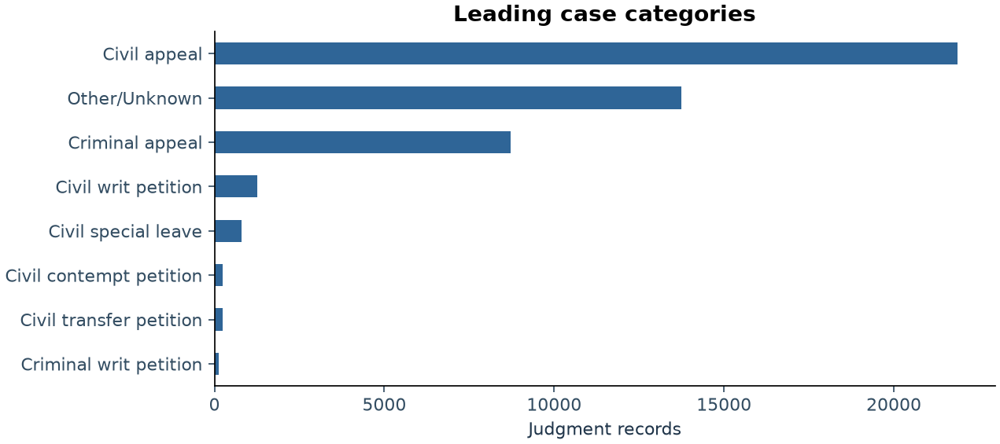

# Indian Supreme Court Judgment Analytics

A reproducible analysis of **47,400 Indian Supreme Court judgment records** and their linked PDFs. It combines metadata cleaning and visualization, legal-concept association mining, document clustering, and a local versus PySpark benchmark.

*IIITDM Kancheepuram · Analytics & Systems of Big Data Practice · November 2025 End-Semester Examination*

[Executed notebook](main.ipynb) · [Python stages](tools/asbd_stages/) · [Figures](figures/) · [Kaggle dataset](https://www.kaggle.com/datasets/vangap/indian-supreme-court-judgments)



## Results

| Analysis | Finding | Evidence |
| --- | --- | --- |
| Data quality and descriptive analytics | Cleaned 47,400 metadata records and matched 47,388 to PDFs. The notebook explains ten distinct plot types. | [Metadata summary](outputs/metadata_summary.json), [plot interpretations](outputs/descriptive_figures.json) |
| Sample composition | Of 4,000 sampled PDFs, 3,843 were readable. The largest difference in case-category share was 0.43 percentage points. | [Extraction summary](outputs/pdf_summary.json), [category comparison](outputs/sample_representativeness.csv) |
| FP-Growth | At 2% support, 50% confidence, and 1.10 minimum lift, the original workload yielded 192 frequent itemsets and 417 rules. | [Itemsets](outputs/fp_itemsets.csv), [rules](outputs/fp_rules.csv), [support sensitivity](outputs/fp_support_sensitivity.csv) |
| A-Close | All 192 frequent itemsets were closed in the original workload. In the 1,000-document prefix, 172 of 193 were closed, a 10.88% reduction. | [Closed itemsets](outputs/aclose_closed_itemsets.csv), [rules](outputs/aclose_rules.csv), [worked example](outputs/aclose_workload_comparison.json) |
| K-Medoids | Five clusters scored highest among the tested values of k = 2–5 on 560 documents. A mean silhouette of 0.109 indicates weak separation. | [Trials](outputs/kmedoids_trials.csv), [medoids and terms](outputs/kmedoids_clusters.csv) |

The category comparison tests one dimension of sample coverage. Year, language, and extraction success can still affect coverage. The association rules describe textual co-occurrence, and the document clusters are exploratory.

## PySpark benchmark

Both PySpark implementations agreed with their local counterparts in **all 14 paired runs**. Spark 4.0.1 ran on two threads (`local[2]`) and was slower in all six median comparisons. Timings include input preparation, mining and result collection. Session startup and warm-up were measured separately.

| Transactions | Algorithm | Local median | Spark median | Local ÷ Spark |
| ---: | --- | ---: | ---: | ---: |
| 1,000 | FP-Growth | 0.0118 s | 0.5357 s | 0.0220x |
| 1,000 | A-Close | 0.0029 s | 2.0108 s | 0.0015x |
| 3,843 | FP-Growth | 0.0297 s | 0.4798 s | 0.0619x |
| 3,843 | A-Close | 0.0058 s | 2.5108 s | 0.0023x |
| 9,591 | FP-Growth | 0.0534 s | 0.7057 s | 0.0757x |
| 9,591 | A-Close | 0.0151 s | 5.5545 s | 0.0027x |

These measurements describe a single machine. Input conversion, repartitioning, scheduling, and driver collection added overhead, and the experiment did not establish multi-machine scalability. [Original runs](outputs/spark_benchmark_runs.csv) · [Extended runs](outputs/spark_extended_benchmark_runs.csv)

## Reproduce the analysis

Use Python 3.13, Java 17, and the package versions in [requirements.txt](requirements.txt). Download the [Kaggle archive](https://www.kaggle.com/datasets/vangap/indian-supreme-court-judgments) and place the source files at `data/judgments.csv` and `data/pdfs/` in the repository root.

```powershell
python -m pip install -r requirements.txt
python tools/run_asbd.py --fresh
```

The runner saves each executed notebook stage. Omit `--fresh` to reuse a compatible extraction checkpoint. To run interactively, launch `jupyter lab` from the repository root and open `main.ipynb`.

To reproduce the extended Spark benchmark after the original run, use `python tools/benchmark_larger_spark.py`. It samples additional distinct filenames, extracts text, and writes separate benchmark results. Elapsed times will vary by machine.

## Repository contents

| Path | Contents |
| --- | --- |
| [`main.ipynb`](main.ipynb) | Executed analysis with figures and interpretations |
| [`tools/asbd_stages/`](tools/asbd_stages/) | Commented source for the notebook's eight stages |
| [`tools/run_asbd.py`](tools/run_asbd.py) | Notebook assembly and execution |
| [`tools/benchmark_larger_spark.py`](tools/benchmark_larger_spark.py) | Extended 9,591-transaction experiment |
| [`figures/`](figures/) | Descriptive and algorithm figures |
| [`outputs/`](outputs/) | Selected result tables and summaries |

The raw archive, bulk record-level exports, extraction journals, backups, and local report builds are excluded from Git.

